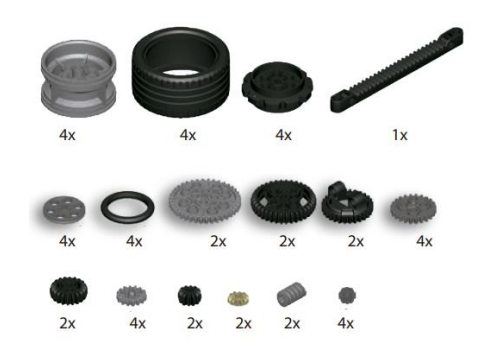
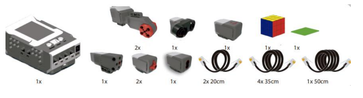
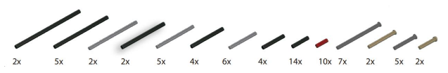
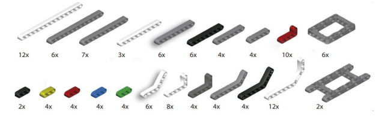
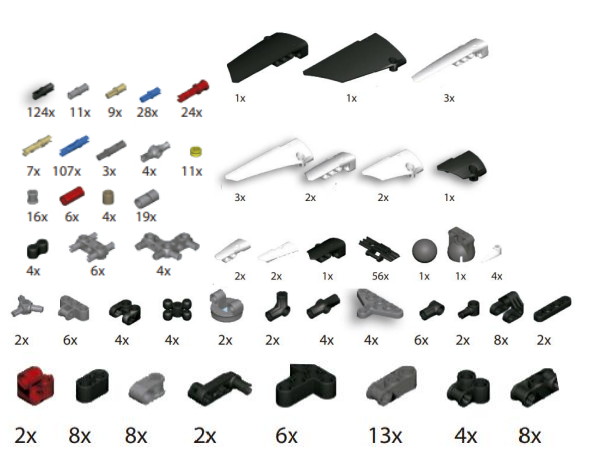
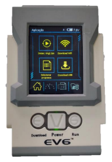
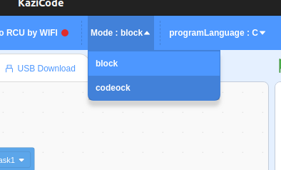
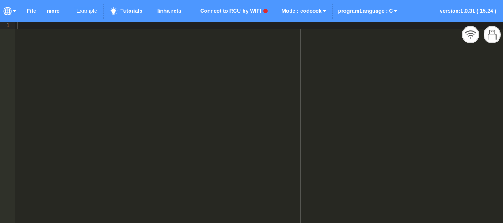
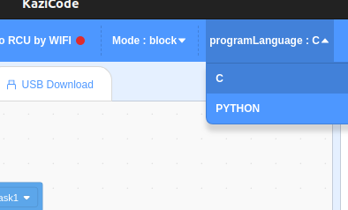

# EDO6-doc

Documentação comunitária para o conjunto de robótica educacional EDO6.

Este repositório nasceu da necessidade de fazer o kit funcionar quando o manual
e os links oficiais já não respondiam tudo. Aqui reunimos material de aula,
testes, exemplos e pequenas descobertas — inclusive aquelas peças que nem sempre
encaixam de primeira ¯\\_(ツ)_/¯.

> [!IMPORTANT]
> Este é um projeto independente e não oficial. Sempre que possível, indicamos o
> que foi observado no software, o que veio do manual e o que ainda precisa ser
> confirmado no equipamento.

## Por onde começar

| Quero... | Ir para |
| --- | --- |
| baixar o KaziCode | [Downloads e verificação dos arquivos](./docs/instalacao/) |
| instalar no Windows | [Instalação no Windows](./docs/instalacao/windows.md) |
| instalar no Linux | [Instalação no Linux](./docs/instalacao/linux.md) |
| programar com blocos | [Usando blocos](./blocos_doc/) |
| programar em C | [Programação em C](./docs/programacao/c.md) |
| montar a base do carrinho | [Base motriz](./base-motriz/) |
| consultar as aulas | [Material das aulas](./aulas/) |

## ED06 ou EDO6?

Os dois nomes aparecem em manuais, arquivos e buscas sobre o kit. Neste projeto
usamos **EDO6** como nome principal, mas mantemos **ED06** em alguns trechos para
que a documentação continue fácil de encontrar.

## Sobre o kit

O conjunto de robótica educacional EDO6 permite transformar conteúdos de
ciências, tecnologia, engenharia, artes e matemática em protótipos funcionais.
As mais de 750 peças podem ser usadas por grupos de 2 a 4 estudantes em projetos
sem motor, motorizados ou automatizados.

As peças plásticas são encaixáveis e, em geral, dispensam ferramentas. Os
componentes mecânicos e eletrônicos foram feitos para trabalhar em conjunto com
a controladora do kit.

## Componentes

### Rodas, pneus e engrenagens

### Sensores, atuadores e cabos

### Eixos

### Vigas

### Conectores e peças complementares

Entre os componentes eletrônicos encontrados no conjunto estão:

- 1 motor de corrente contínua de 5 V, tamanho médio;
- 2 motores de corrente contínua de 5 V, tamanho grande;
- 2 sensores de toque;
- 1 sensor ultrassônico;
- 1 sensor giroscópio;
- 1 sensor de cor.

## Controladora

O KaziCode chama o perfil usado pelos exemplos deste repositório de `EV6`. A
inspeção do compilador desse perfil mostrou:

- arquitetura ARM Cortex-M3;
- família STM32F10x de alta densidade;
- frequência de compilação de 72 MHz;
- 512 KiB de flash e 64 KiB de RAM descritos no linker;
- FreeRTOS e a biblioteca de hardware `KYLib`;
- programa do usuário gravado em uma região reservada da flash.

> [!NOTE]
> Os arquivos do fabricante mencionam tanto STM32F103ZE quanto STM32F103VET6.
> Por isso, evitamos afirmar o encapsulamento exato sem conferir fisicamente a
> placa. O alvo de compilação, entretanto, é claramente STM32F10x/Cortex-M3.

Outras informações presentes no material original incluem tela colorida de 2,4
polegadas, resolução de 320×240, oito entradas RJ12 para sensores, saídas RJ12
para motores e alimentação por USB, pilhas, bateria recarregável ou fonte
externa. Alguns valores do manual entram em conflito entre si e ainda precisam
ser medidos no equipamento.

## KaziCode

Os antigos links em `file.kazi.ai` deixaram de funcionar. Conseguimos recuperar
o KaziCode 1.0.31 e registramos a origem, a versão interna e os checksums na
[página de downloads](./docs/instalacao/).

O programa oferece dois caminhos principais:

- programação visual baseada em Scratch 3;
- código textual, incluindo C e Python.

Por padrão, o KaziCode abre no modo de blocos. Para mudar o ambiente, use o
seletor de modo no menu superior:

O modo `Codeock` abre o editor textual:

Depois, selecione a linguagem desejada no menu ao lado:

Para C, consulte o [guia específico](./docs/programacao/c.md). Ele descreve o
fluxo real usado pelo KaziCode: compilação, link, geração do `.bin` e cópia para
a controladora.

## Montagens e exemplos

- [Base motriz](./base-motriz/)
- [Movimentos](./aulas/aula_02-locomocao/CODIGO-movimento/)
- [Sensor giroscópio](./aulas/aula_03-manipulacao/CODIGO-movimento_giroscopio/)
- [Sensor ultrassônico](./aulas/aula_04-sensores/CODIGO-sensor_de_obstaculo/)
- [Sensor de cor e seguidor de linha](./aulas/aula_04-sensores/CODIGO-sensor_de_cores_e_luz/)

## Encontrou algo diferente?

Este material fica melhor quando alguém testa no kit e conta o que aconteceu.
Ao abrir um issue, informe o modelo selecionado no KaziCode, o sistema
operacional, a arquitetura do computador e, se houver erro, envie a mensagem
completa. Fotos da tela da controladora também ajudam bastante.
