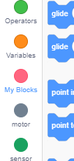
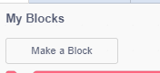
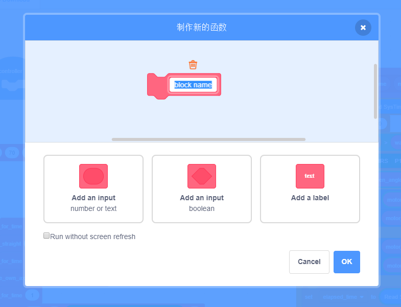
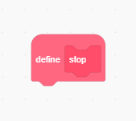
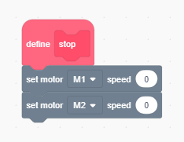
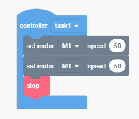
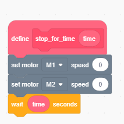

# Usando blocos

## Funções

Podemos criar funções no KaziCode por meio da categoria `My Blocks`.

---

No início, essa categoria não possui blocos prontos: é aqui que criamos nossos
próprios blocos de execução — em resumo, nossas funções.

---

Os blocos podem receber parâmetros e usá-los durante a execução. Dê um nome
ao novo bloco, adicione os parâmetros necessários e continue.

---

O bloco criado aparece na barra de blocos disponíveis. Sua definição funciona
como uma função: dentro dela colocamos as instruções que devem ser executadas.
No exemplo abaixo, o novo bloco para os motores do carrinho.

---

Para usar o novo bloco, arraste-o da categoria `My Blocks` para a tarefa que está
montando.

---

Também podemos criar blocos com parâmetros booleanos ou variáveis.

